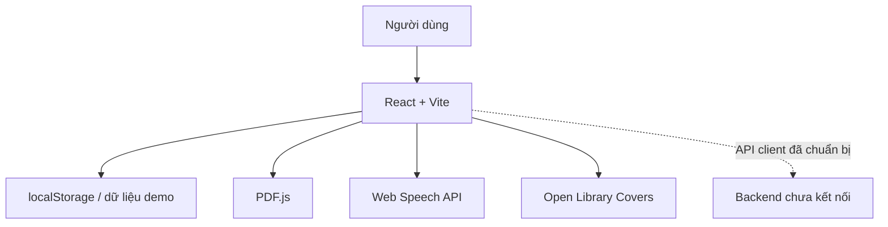
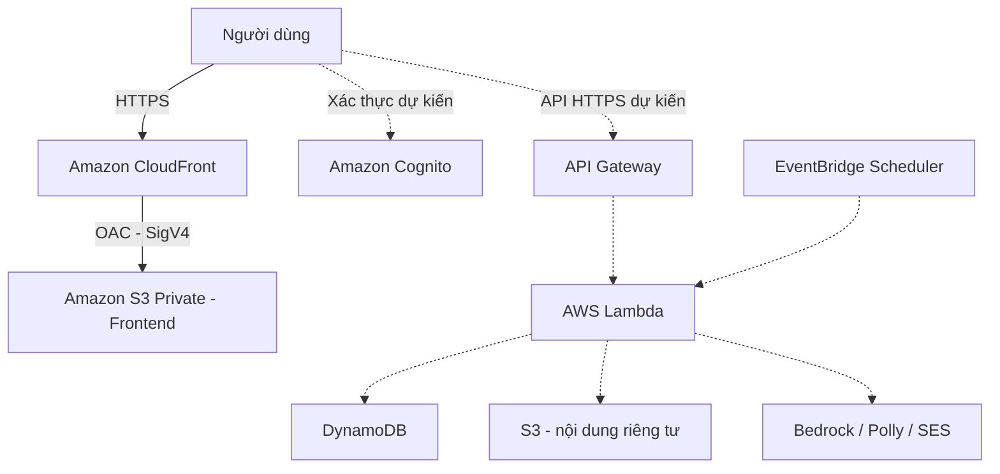

# Cloud Library Management System

Hệ thống quản lý thư viện và đọc sách trực tuyến, phát triển bằng **React + Vite**, hướng tới kiến trúc điện toán đám mây trên AWS. Dự án hỗ trợ độc giả, tác giả, thủ thư và quản trị viên trong các nghiệp vụ đọc sách, mượn trả, quản lý tài nguyên và xuất bản tác phẩm.

> **Trạng thái (24/11/2026): Frontend Demo đã hoàn thiện và kiểm thử local theo phạm vi bàn giao.** Release `20261124-183208` đã được đóng gói và kiểm tra tính toàn vẹn. Chưa kết nối Backend thực tế, chưa triển khai AWS và chưa nghiệm thu trên cloud. Dữ liệu nghiệp vụ demo được lưu trong trình duyệt, không phải dữ liệu dùng chung nhiều người dùng.

## 1. Chức năng đã thực hiện

| Phân hệ | Chức năng hiện có |
| --- | --- |
| Tài khoản | Đăng nhập, đăng ký demo, hồ sơ cá nhân, phân quyền hiển thị theo vai trò; khóa và quản lý tài khoản trong phạm vi demo. |
| Danh mục | Khám phá, tìm kiếm, lọc theo thể loại, danh mục tác giả, chi tiết sách và ảnh bìa. |
| Yêu thích | Thêm/bỏ yêu thích, lưu trạng thái local, xử lý lỗi lưu; chưa kiểm thử độ trễ API thật. |
| Mượn trả | Yêu cầu mượn, duyệt, bàn giao, trả/hủy sách; kiểm tra trạng thái và số bản khả dụng. |
| Đặt trước | Hàng đợi đặt sách, giữ sách trong 48 giờ khi đến lượt theo quy tắc demo, quản lý trạng thái đặt trước. |
| Gia hạn và tiền phạt | Gia hạn phiếu mượn, theo dõi quá hạn, tính và ghi nhận phí trong demo. |
| Kho sách | Quản lý từng bản sao, mã bản sách, trạng thái và bảo trì; kiểm tra tính nhất quán tồn kho. |
| Đọc Online | Đọc PDF hoặc nội dung theo chương, zoom, chuyển trang/chương bằng nút, vuốt hoặc cuộn, lưu vị trí đọc, tùy chỉnh giao diện đọc và font hỗ trợ tiếng Việt. |
| Audio Player | Đọc nội dung bằng giọng trình duyệt; phát, tạm dừng, dừng, chuyển đoạn, chọn giọng, tốc độ và âm lượng; ghi nhớ cài đặt, đọc liên tục ở chế độ nút/vuốt. |
| Thông báo | Trung tâm thông báo nghiệp vụ, nhắc hạn trả tại các mốc 5 ngày, 1 ngày, đúng hạn và quá hạn trong demo. |
| Trợ lý | Hỏi đáp bằng văn bản và tra cứu danh mục sách mẫu theo logic demo; chưa gọi mô hình AI thật. |
| Tác giả | Đăng ký tác giả, tạo/chỉnh sửa bản thảo và chương, xem trước, gửi duyệt, chỉnh vị trí/thu phóng ảnh bìa. |
| Quản trị | Quản lý sách, độc giả, nhân sự, thể loại, duyệt tác giả/tác phẩm, quyền tài khoản, cấu hình thư viện, lịch sử và thống kê demo. |
| Giao diện | Theme sáng/tối, tiếng Việt/tiếng Anh, căn chỉnh bố cục, hỗ trợ màn hình hẹp và lưu tùy chọn giao diện. |

### Các cải tiến sau góp ý của nhóm

- Sửa font tiếng Việt ở trình đọc và các tiêu đề bị lỗi; căn chỉnh các khung/nút điều hướng, loại bỏ tiêu đề quản trị trùng lặp.
- Chặn hạn trả không hợp lệ: từ ngày mai đến tối đa 60 ngày; thời hạn mặc định theo cấu hình thư viện (14 ngày mặc định). Hiển thị `DD/MM/YYYY` khi dùng tiếng Việt, `YYYY/MM/DD` khi dùng tiếng Anh; lưu ngày theo dạng ISO `YYYY-MM-DD`.
- Nhắc hạn theo ngày trả hiện hành, hiển thị mốc phù hợp gần nhất, cập nhật khi gia hạn hoặc trả sách, hạn chế trùng thông báo.
- Chỉnh ảnh bìa bằng kéo, điều chỉnh vị trí, thu phóng và đặt lại. Lưu metadata `coverFraming`, giữ ảnh gốc; chưa upload S3 hoặc cắt pixel ảnh.
- Gỡ trang Nghe & Hỏi cũ và nhận dạng giọng nói; chuyển chức năng nghe sách vào Đọc Online, giữ trợ lý văn bản.
- Chuẩn bị component `AccountRecovery.jsx` để xác minh email; **chưa gắn vào luồng đăng nhập demo và chưa gọi API xác minh thật**.
- Giữ nguyên chức năng mật khẩu nhân sự và lựa chọn giọng đọc hiện tại; nâng cấp giọng Neural AI/tự nhận diện ngôn ngữ được tạm hoãn.

## 2. Công nghệ và dịch vụ đã sử dụng

| Công nghệ / dịch vụ | Mục đích | Trạng thái |
| --- | --- | --- |
| React 19, Vite 8 | Xây dựng giao diện SPA và đóng gói production | Hoạt động local |
| JavaScript, CSS, Lucide React | Logic giao diện, styling và biểu tượng | Hoạt động local |
| Browser localStorage | Lưu dữ liệu nghiệp vụ và tùy chọn demo | Hoạt động local; không thay thế database |
| PDF.js (`pdfjs-dist` 6.5.438) | Hiển thị PDF, trích xuất văn bản | Hoạt động local |
| Web Speech API (`speechSynthesis`) | Đọc thành tiếng nội dung sách | Hoạt động trên trình duyệt hỗ trợ |
| Open Library Covers | Lấy ảnh bìa theo ISBN khi có ISBN hợp lệ | Đã dùng URL dịch vụ ảnh; phụ thuộc mạng và nguồn ảnh |
| PDF mẫu Mozilla | Nguồn PDF để thử trình đọc | Đã dùng URL mẫu bên ngoài |
| Fetch API và API Client | HTTP request, Bearer token, timeout, abort, lỗi API, idempotency | Đã chuẩn bị, kiểm thử mock; chưa nối Backend thật |
| ESLint, npm audit | Kiểm tra chất lượng mã và phụ thuộc | Đã chạy local |
| PowerShell, Python | Đóng gói, xác minh checksum, lập kế hoạch triển khai, kiểm thử và bàn giao | Đã kiểm thử offline |

**Phân biệt:** Web Speech API là khả năng của trình duyệt/hệ điều hành, không phải Amazon Polly hay dịch vụ AI Neural do dự án tích hợp. Open Library được dùng cho ảnh bìa, không phải nguồn đồng bộ toàn bộ danh mục. Việc một package SDK xuất hiện trong `package.json` không chứng minh dịch vụ tương ứng đã được kết nối.

## 3. Dịch vụ AWS và Backend: đã chuẩn bị và chưa tích hợp

Bản README này mô tả **bản Frontend local 8R/8S**. Các dịch vụ trong kiến trúc tổng thể dưới đây không được coi là hoạt động chỉ vì có thiết kế, adapter hoặc tài liệu tham chiếu của nhóm.

| Dịch vụ | Vai trò dự kiến | Trạng thái trong bản Frontend hiện tại |
| --- | --- | --- |
| Amazon S3 | Lưu HTML/CSS/JS và tài nguyên website trong bucket private | Có template hosting; chưa tạo bucket/upload AWS |
| Amazon CloudFront | Phân phối website HTTPS qua CDN | Có template và công cụ kiểm tra; chưa tạo distribution |
| CloudFront Origin Access Control (OAC) | CloudFront ký yêu cầu đọc S3 riêng tư | Đã khai báo trong template; chưa kích hoạt thực tế |
| AWS CloudFormation | Tạo hạ tầng hosting từ YAML | Đã chuẩn bị template; chưa chạy stack/validate trên AWS |
| AWS IAM / STS | Quản lý quyền và xác minh đúng tài khoản triển khai | Đã chuẩn bị nguyên tắc quyền và kiểm tra tài khoản trong công cụ; chưa kiểm chứng quyền thật |
| Amazon Cognito | Xác thực, đăng ký, xác minh email, token và vai trò | Chưa kết nối; hiện dùng demo auth |
| Amazon API Gateway | Cung cấp HTTP API nghiệp vụ | Chưa kết nối endpoint thật |
| AWS Lambda | Xử lý nghiệp vụ phía Backend | Chưa tích hợp hoặc kiểm thử cùng FE |
| Amazon DynamoDB | Lưu tài khoản, sách, mượn trả, tồn kho, tiến độ đọc và dữ liệu dùng chung | Chưa kết nối; hiện dùng localStorage |
| Amazon S3 (kho nội dung) | PDF, bìa, chương, audio riêng tư và URL ký sẵn | Chưa tích hợp upload/read-access thật; khác với bucket hosting |
| Amazon Bedrock | Trợ lý hỏi đáp bằng mô hình AI | Chưa kết nối; trợ lý hiện tra cứu demo |
| Bedrock Knowledge Bases / Titan Embeddings / S3 Vectors | Tra cứu tri thức và RAG theo tài liệu kiến trúc nhóm | Chưa tích hợp, chưa kiểm thử |
| Amazon Polly | Tổng hợp giọng đọc từ dịch vụ cloud | Chưa tích hợp; Audio Player dùng Web Speech API |
| Amazon Transcribe | Nhận dạng giọng nói | Chưa tích hợp; tính năng STT cũ đã gỡ khỏi FE |
| Amazon SES | Gửi email xác minh/thông báo nghiệp vụ | Chưa kết nối email thật |
| Amazon EventBridge Scheduler | Lập lịch nhắc hạn và xử lý hàng đợi | Chưa tích hợp; nhắc hạn hiện cập nhật khi website mở |
| AWS Secrets Manager | Lưu bí mật dịch vụ phía server | Chưa tích hợp trong FE; không lưu khóa bí mật phía trình duyệt |
| Amazon CloudWatch | Log, giám sát và cảnh báo hạ tầng | Chưa cấu hình/kiểm chứng cloud |
| Azure AI Speech (ngoài AWS, tùy chọn) | Giọng Neural tự nhiên và đa ngôn ngữ | Tạm hoãn; chưa tích hợp |

Nhóm dịch vụ S3/CloudFront/OAC/CloudFormation có **cấu hình hạ tầng Frontend cụ thể**. Các dịch vụ Backend còn lại là phần kiến trúc tham chiếu và cần được xác nhận với thành viên phụ trách Backend/AWS. Không có bằng chứng nghiệm thu cloud thực tế trong bản bàn giao này.

## 4. Kiến trúc hệ thống

### Hiện tại — Frontend Demo



### Dự kiến — AWS hosting và tích hợp Backend



Sơ đồ thứ hai là kiến trúc mục tiêu, không phải sơ đồ tài nguyên đang chạy. Region dự kiến cho stack và S3: `ap-southeast-1` (Singapore). CloudFront là dịch vụ toàn cầu. Template hosting dùng S3 REST origin, chặn public access, OAC ký SigV4, HTTPS redirect và `index.html` làm default root object. Không bật S3 Static Website Hosting cho kiến trúc này.

## 5. Cài đặt và chạy local

### Yêu cầu

- Node.js 22.13+ trong nhánh 22 LTS hoặc phiên bản Node 24 tương thích với lockfile; npm.
- Trình duyệt hiện đại có hỗ trợ PDF.js và Web Speech API (ví dụ Edge hoặc Chrome).
- Python 3.9+ và PowerShell nếu sử dụng công cụ triển khai/bàn giao; ưu tiên phiên bản Python còn được hỗ trợ.

Từ thư mục gốc dự án:

```powershell
npm ci
npm run dev
```

Mở URL Vite hiển thị, thường là `http://localhost:5173/`.

Kiểm tra production build:

```powershell
npm run lint
npm run build
npm audit --omit=dev --audit-level=high
npm run preview
```

Mở URL preview, thường là `http://localhost:4173/`. Dùng `Ctrl+C` để dừng server.

### Cấu hình môi trường

Giữ cấu hình Demo hiện tại; các biến dưới đây là ví dụ tham chiếu, **không phải chỉ dẫn ghi đè `.env` đang dùng**:

```dotenv
VITE_API_BASE_URL=/api/v1
VITE_RESERVATION_SOURCE=demo
VITE_LOAN_EXTRAS_SOURCE=demo
VITE_BOOK_COPIES_SOURCE=demo
VITE_VOICE_SOURCE=demo
```

Chưa có công tắc chuyển toàn bộ ứng dụng sang API Mode hoàn chỉnh. Không đổi các flag riêng lẻ sang `api` khi chưa có hợp đồng API và auth thật. Không đặt AWS credentials, API key, mật khẩu hoặc token bí mật trong biến `VITE_*`, vì giá trị có thể được đưa vào bundle public.

## 6. Cấu trúc thư mục

```text
CloudLibraryManagementSystem/
├── public/                  # Tài nguyên tĩnh
├── src/
│   ├── api/                 # API client, wrapper và catalog adapter
│   ├── assets/              # Ảnh, tài nguyên giao diện
│   ├── components/          # Component tái sử dụng
│   ├── data/                # Dữ liệu demo và quy tắc nghiệp vụ
│   ├── hooks/               # React hooks
│   ├── pages/               # Các trang chức năng, trình đọc và audio
│   ├── services/            # Service/adapter demo và API dự kiến
│   ├── ui/                  # Store, workflow, thông báo, i18n, PDF
│   └── App.jsx              # Điều hướng và tích hợp giao diện
├── test/                    # Kiểm thử logic Frontend (bản local)
├── aws-release/             # Hồ sơ, release và bộ công cụ local
│   ├── history/             # Snapshot theo phiên bản
│   ├── handoff/             # Bộ ZIP bàn giao
│   └── step11/              # Công cụ plan/deploy/smoke/rollback
├── package.json
├── package-lock.json
├── vite.config.js
├── eslint.config.js
└── README.md
```

`node_modules/` và `dist/` được tạo khi cài đặt/build. `aws-release/` là thư mục công cụ và sản phẩm bàn giao local; không đưa nguyên thư mục này lên hosting public. Một số thư mục local có thể không xuất hiện khi clone Git hoặc giải nén bộ bàn giao vì chúng không thuộc phạm vi source được đóng gói.

## 7. Kiểm thử và bảo mật

Kết quả ghi nhận từ log và xác nhận kiểm thử local đến ngày 24/11/2026:

| Hạng mục | Kết quả |
| --- | --- |
| ESLint và production build | PASS |
| npm audit cho phụ thuộc production | 0 vulnerabilities tại lần kiểm tra đã ghi nhận |
| Kiểm thử nghiệp vụ/UI, audio và bản vá 8R | Người thực hiện báo PASS |
| API Client với mock fetch/Response | 13/13 PASS |
| Công cụ triển khai với mock AWS/HTTP | 13/13 PASS |
| Kiểm tra ZIP release chính và dự phòng | Cả hai PASS, mỗi ZIP 64 objects |
| Kiểm tra mã nguồn/cấu hình bàn giao | 140 file khớp checksum |
| Kiểm tra hồ sơ/công cụ | 13 file khớp checksum |
| Đóng gói bộ bàn giao | 164 file, HANDOFF PASS |
| Backend thật, AWS thật và nghiệm thu nhiều người dùng | Chưa thực hiện |

Chạy thêm kiểm thử offline nếu đã có bộ công cụ trong `aws-release/`:

```powershell
node --test .\aws-release\backend-readiness.test.mjs
py -m unittest discover -s .\aws-release\step11 -p "test_*.py" -v
py .\aws-release\step11\cloudlibrary_deploy.py plan
py .\aws-release\step11\cloudlibrary_deploy.py plan --release 20261124-180451
```

Các lệnh kiểm thử và `plan` không gọi AWS. Log kiểm thử Python có một `ResourceWarning` về HTTPError giả lập nhưng không có test thất bại.

### Lưu ý bảo mật

- PDF.js đã được nâng cấp lên `6.5.438` để xử lý lỗ hổng đã phát hiện tại thời điểm kiểm tra. Cần kiểm tra lại phụ thuộc trước khi triển khai công khai; kết quả audit không phải chứng nhận an toàn tuyệt đối.
- Bộ tạo release kiểm tra tên file nhạy cảm và mẫu credentials. Ngoại lệ OpenJPEG chỉ áp dụng file và SHA256 đã đối chiếu với thư viện gốc, một chuỗi nhúng khớp mẫu Access Key, không có marker Private Key. Đây là xác minh local, không phải kiểm toán nguồn cung ứng độc lập.
- Vite có cảnh báo một số chunk trên 500 kB; không chặn build nhưng cần đo và tối ưu hiệu năng khi triển khai thật.
- Phân quyền, tài khoản, giao dịch và dữ liệu demo phía trình duyệt không có giá trị kiểm soát truy cập production. Backend phải kiểm tra quyền, tồn kho, hạn trả, trạng thái và idempotency độc lập.
- Không đưa dữ liệu cá nhân thật, mật khẩu thật hoặc AWS credentials vào demo, source, ZIP public hoặc Git.

## 8. Release và bàn giao

| Mục | Thông tin |
| --- | --- |
| Release chính (8S, sau chỉnh sửa 8R) | `20261124-183208` |
| Release dự phòng (trước chỉnh sửa 8R) | `20261124-180451` |
| Frontend | Production build — Demo Mode |
| Deployment | **NOT DEPLOYED** |

**Release chính:** `aws-release/history/20261124-183208/cloudlibrary-frontend-dist.zip`

SHA256: `27F379C17D5B95D38C8204C958DFC0FE69F099620DFE22DE5624568B91B083D2`

**Release dự phòng:** `aws-release/history/20261124-180451/cloudlibrary-frontend-dist.zip`

SHA256: `B43D2B1EF1B4FEC5A865F2BC2A630660A9F98E48D743250318CC4BFA20FC1624`

**Bộ bàn giao:** `aws-release/handoff/CloudLibrary-HANDOFF-20261124-183208.zip`

SHA256: `1F01F5C46666F821C0AE24088D26CCE2BC623FE6B20F6FFB9D551B879F25161D`

Bộ bàn giao đã tạo chứa mã nguồn/cấu hình được đối chiếu, hai Release, template hosting, tài liệu API, công cụ triển khai và rollback. Các checksum trên áp dụng cho đúng file đã đóng gói ngày 24/11/2026, không áp dụng cho ZIP được sửa hoặc tạo lại sau đó.

### Tài liệu triển khai (có trong bộ bàn giao/local)

- `START-HERE.md` — hướng dẫn bắt đầu trong ZIP bàn giao.
- `aws-release/AWS-HANDOFF.md` — hồ sơ kỹ thuật và quy trình triển khai.
- `aws-release/BACKEND-INTEGRATION.md` — đối chiếu hợp đồng API và phần còn thiếu.
- `aws-release/step11/BACKEND-REQUEST.md` — thông tin cần nhận từ Backend.
- `aws-release/step11/README-11A-11E.md` — sử dụng công cụ triển khai và rollback.
- `aws-release/step11/DEPLOYMENT-CHECKLIST.md` — checklist và nhật ký nghiệm thu.
- `aws-release/cloudlibrary-hosting.yaml` — template hạ tầng hosting dự kiến.

Chỉ khi thành viên phụ trách AWS có quyền hợp lệ và xác nhận môi trường mới thực hiện tạo stack, upload **nội dung giải nén của Release** lên S3, invalidation và kiểm thử CloudFront. Không upload ZIP bàn giao lên website public. Công cụ deploy/rollback đã kiểm thử giả lập, chưa chạy với AWS thật; rollback chỉ khôi phục Frontend, không khôi phục database hay Backend.

## 9. Công việc chưa hoàn thành / giới hạn

- [ ] Thống nhất API chính thức, môi trường test, schema, auth/CORS và quyền truy cập với nhóm Backend; một số endpoint FE hiện tại khác tài liệu Backend ngày 20/11/2026.
- [ ] Tích hợp đăng nhập và xác minh email thật, đồng bộ danh mục, mượn trả, yêu thích, quyền đọc, thông báo và dữ liệu tài khoản phía server.
- [ ] Đo độ trễ API yêu thích; bổ sung optimistic update/rollback với server thật, xử lý thao tác nhanh và lỗi mạng.
- [ ] Lưu ảnh bìa/PDF trong kho riêng tư; thống nhất lưu metadata khung ảnh và quyền truy cập.
- [ ] Lập lịch nhắc hạn phía Backend khi người dùng không mở website; hiện chỉ nhắc khi ứng dụng chạy.
- [ ] Kết nối mô hình AI thật nếu cần; nâng cấp giọng Neural/tự nhận diện ngôn ngữ đang tạm hoãn.
- [ ] OCR cho PDF scan không có lớp văn bản. Chất lượng giọng hiện tại phụ thuộc trình duyệt; tiến trình audio tính theo đoạn, không phải thời lượng phút/giây chính xác. Chế độ cuộn chỉ đọc trang/chương hiện tại.
- [ ] Triển khai CloudFormation, S3 và CloudFront, kiểm thử HTTPS, MIME, quyền truy cập private, cache và hiệu năng trên cloud.
- [ ] Kiểm thử tích hợp FE–BE, bảo mật server, đa người dùng, rollback thật, giám sát chi phí và nghiệm thu toàn hệ thống.

## 10. Phạm vi đóng góp Frontend

Đã hoàn thiện các chức năng giao diện và nghiệp vụ demo, xử lý góp ý của nhóm, nâng cấp phụ thuộc PDF.js, kiểm tra chất lượng mã, chuẩn bị API client, kiến trúc hosting AWS, quy trình release, tài liệu bàn giao, công cụ triển khai và rollback. Mã nguồn Backend, triển khai cloud và nghiệm thu hệ thống thật cần được phối hợp với các thành viên phụ trách.

**Trạng thái chốt:** Frontend Demo và bộ bàn giao local đã được kiểm thử; Backend và AWS vẫn là các đầu việc tích hợp/triển khai tiếp theo.
